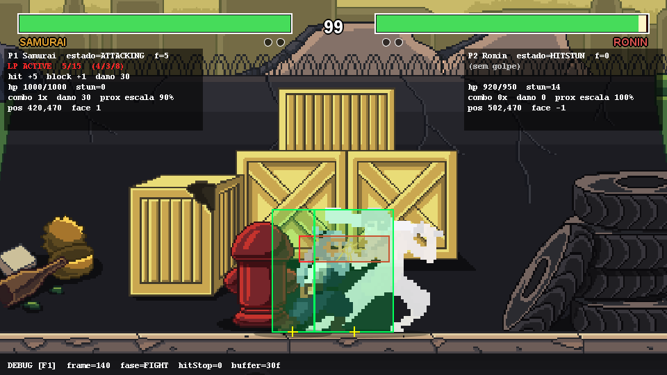
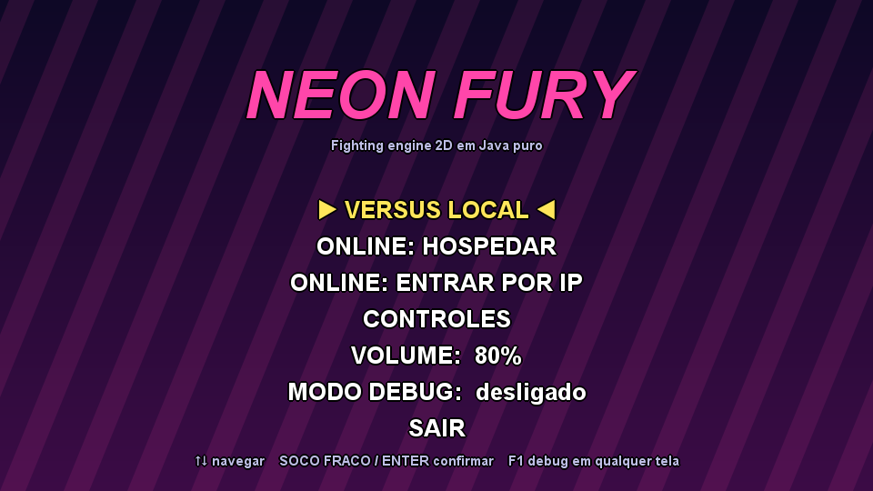
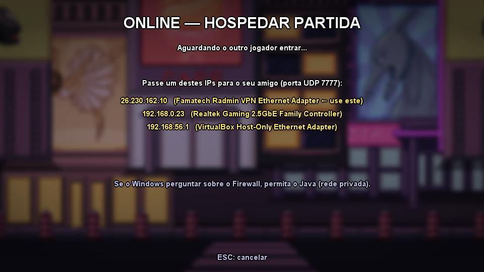
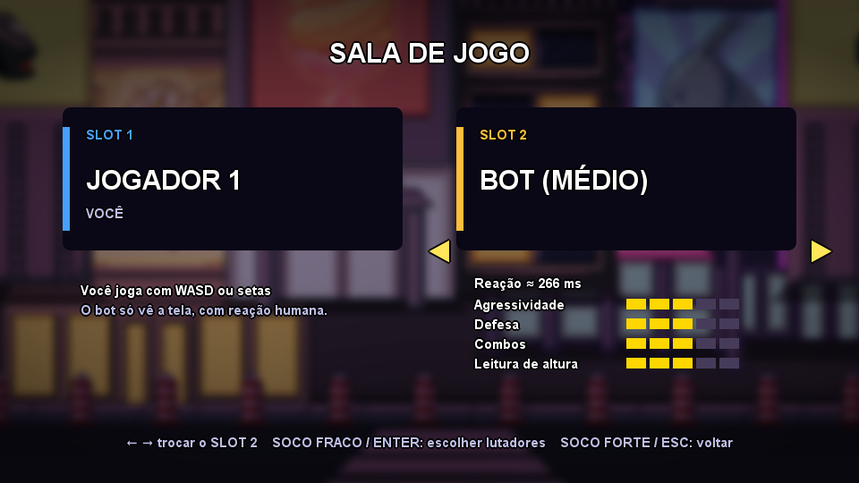
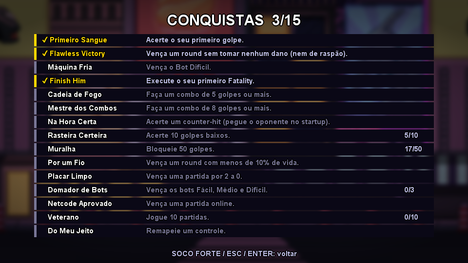
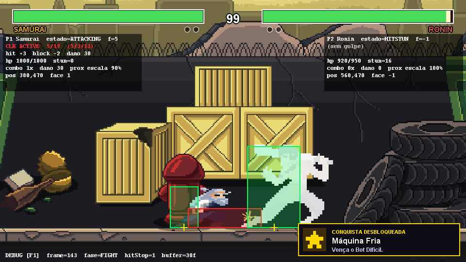

# KURO FIGHTER — Estudo de caso: um jogo de luta determinístico, em rede e sem lixo

> **O código do motor é fechado.** Este repositório é uma documentação pública de arquitetura e de decisões de engenharia: o que foi construído, por que, o que foi descartado e o que foi medido. Não há código-fonte do jogo aqui.
> Os nomes de arquivos, classes, testes e scripts citados (`log.md`, `como_funciona.md`, `test.bat`, `RenderShot`, `GcProbe`…) pertencem ao repositório privado. Se você está avaliando meu trabalho e quer ver mais, é só pedir: berlofaspike@gmail.com.

> Motor de jogo de luta 2D em **Java puro** (JDK 25, Swing/Java2D, sem engine). Versão documentada: **0.5.0** (2026-10-06).
> Este é o documento de arquitetura: **o que** foi construído, **por que** cada padrão foi escolhido, o que foi descartado e quanto custou.
> Complementa `log.md` (status e changelog) e `como_funciona.md` (matemática e leitura do código).
> Os números abaixo foram **medidos** pelos testes do repositório (seção 8 diz como repetir). O que não foi provado está dito na seção 9.



## Resumo em uma tela

| Pergunta | Decisão | Evidência (medida) |
|---|---|---|
| Como garantir que "4 frames de startup" seja sempre 4? | passo fixo de 60 Hz, simulação separada do desenho, **ponto fixo `int`** (sem `float`, sem `Random`, sem relógio) | `SimTest`: 98 verificações, incluindo frame data simulada contra a fórmula |
| Como organizar os comportamentos do lutador? | **máquina de estados** (State): 9 estados, singletons sem dados; adicionar estado = adicionar classe | transições testadas sem janela; zero alocação por transição |
| Como jogar online sem servidor? | **UDP direto + lockstep com atraso de input** sobre LAN virtual (Radmin/Hamachi); só `bits` de input trafegam | com **50% de perda de pacotes** a luta fecha estados idênticos (600 frames em 713 ticks); ≈ **4 KB/s** por direção |
| Como detectar divergência? | checksum do estado a cada 30 frames + `ContentHash` no lobby (dados + versão) | conteúdo diferente é recusado **antes** da luta; divergência vira `Status.DESYNC` |
| O que fazer com o coletor de lixo? | **orçamento de alocação**, medido por `ThreadMXBean`, com teste que falha se estourar | simulação parada **0,0 B/frame**; luta intensa **2,4 B/frame**; rede **3,6 B/tick**; render 44 237 → **836 B/frame** |
| Como fazer uma IA que não trapaceia? | bot é um `InputDevice` com percepção atrasada (nenhum campo de input do oponente) | **0 B/frame**, 0,07 µs/frame; torneio FÁCIL < MÉDIO < DIFÍCIL (16–0 em cada confronto) |
| Como reagir ao jogo sem acoplar? | **Observer** (`EventBus`, eventos `sealed`); conquistas são só mais um assinante | `AchievementTest`: 42 verificações, **0,00 B por evento** |
| Como entregar a quem não tem Java? | `jlink` + `jpackage` em *app-image* | `KuroFighter-win64.zip` de 52 MB; o `.exe` é aberto e verificado pelo próprio empacotador |

**Em duas frases:** a simulação é uma função pura de `(estado, inputs do frame)`. Tudo o mais (rede, IA, conquistas, som, câmera) é uma casca ao redor dela, ligada por `int[] bits` na entrada e por eventos na saída.

| Menu | Online (lobby) | Escolha do slot 2 |
|---|---|---|
|  |  |  |

---

## 1. O problema

Um jogo de luta é um sistema de tempo real com uma exigência incomum: **o resultado precisa ser exato, frame a frame**.
"Este golpe tem 4 frames de startup" só significa algo se a simulação avança em passos idênticos, sempre. Daí vêm
os requisitos que moldaram tudo:

| Requisito | Consequência arquitetural |
|---|---|
| Frame data exata (startup/active/recovery) | loop de **passo fixo** 60 Hz; simulação separada do desenho |
| Multiplayer local agora, P2P depois | simulação **determinística** e alimentada só por *bits de input por frame* |
| Muitos comportamentos por lutador (9 estados) | **State pattern** — sem `if/else` gigante |
| Elenco e mapas crescem sem mexer em código | **Factory** + dados em `.properties` |
| Som, câmera, HUD e partículas reagem ao combate | **Observer** — o combate não conhece quem o escuta |
| Debug visual para balancear | `DebugMode` injetado desde o início, sem `#ifdef` no meio da lógica |

## 2. Visão geral

```
                        ┌────────────────────────── GameEngine (core) ──────────────────────────┐
                        │  janela Canvas · acumulador de tempo · 60 updates/s · 1 render/loop    │
                        └───────────────┬────────────────────────────────────────────────────────┘
                                        │ update()/render()
                              ┌─────────▼──────────┐
                              │ GameStateManager   │   FSM de INTERFACE (State)
                              │ MENU → CHAR → STAGE → FIGHT
                              └─────────┬──────────┘
                                        │ (FightState)
        ┌───────────────────────────────┼───────────────────────────────────────────┐
        │                               │                                           │
┌───────▼────────┐   input bits   ┌─────▼───────────────────────────┐   eventos   ┌──▼─────────────────────┐
│  NetSession    │───────────────►│  FightWorld  (SIMULAÇÃO PURA)   │────────────►│  Observers             │
│  LocalSession  │  1 int / jogador│  Fighter ×2 (FSM) · colisão     │  EventBus   │  AudioManager/Announcer│
│  NetworkSession│   por frame    │  CombatEngine · RoundManager    │             │  Camera (shake/foco)   │
└───────▲────────┘                │  finish-him · fatality          │             │  Hud · Particles       │
        │                         └─────────────▲───────────────────┘             └────────────────────────┘
┌───────┴────────┐                              │ lê (somente leitura)
│ InputManager   │                    ┌─────────┴─────────┐
│ teclado+XInput │                    │ FighterRenderer · Stage · DebugOverlay │  (APRESENTAÇÃO)
└────────────────┘                    └─────────────────────────────────────────┘
```

Regra de ouro: **a seta só aponta para dentro da simulação por `int[] bits`, e só sai por `GameEvent`**.
`FightWorld` não importa `java.awt`, não toca em áudio, não lê teclado, não olha o relógio. Isso é o que permite:
testá-lo sem janela (`SimTest` roda 100 frames em milissegundos), trocar `LocalSession` por rede, e (futuro) *rollback*.

### Dependência entre pacotes

```
core ──► state ──► match ──► fighter ──► combat
  │        │          │         │           ▲
  │        ├──► gfx ──┘         └──► input  │
  │        ├──► audio ◄── event ───────────┘   (event carrega AttackData/StateId)
  │        └──► net
  └──► (Config é usado por todos)
```
`combat` e `input` são folhas: não conhecem ninguém acima. `event` conhece dados do domínio (`AttackData`,
`StateId`) — acoplamento aceito conscientemente (T3 no `log.md`): evento é um *fato do domínio*.

---

## 3. Os padrões e por que cada um

### 3.1 State — a FSM do lutador (`fighter/FighterState`, `FighterStates`)

**Onde:** 9 estados — IDLE, WALKING, JUMPING, CROUCHING, ATTACKING, BLOCKING, HITSTUN, DEAD, FATALITY.

**Por que State e não `switch(state)`:** cada estado tem regras próprias de *entrada*, *frame* e *saída*, e as transições
dependem do estado (de HITSTUN não se pula; de ATTACKING só se sai por cancel ou fim do golpe). Num `switch` gigante,
adicionar o estado BLOCKING exigiria tocar em todos os outros `case`. Com State, **adicionar um estado é adicionar uma classe**
e apontar as transições para ela.

**Detalhe de projeto — flyweight:** os estados são **singletons sem dados** (`FighterStates.IDLE` etc.). Todo dado mutável
(`stateFrame`, `stunFrames`, `attack`, `vx`…) mora no `Fighter`. Resultado: nenhuma alocação por transição (sem lixo para o
GC durante a luta) e a FSM inteira é só ponteiros.

**Trade-off:** os 9 estados ficaram *nested* num único arquivo (`FighterStates.java`, ~250 linhas) para estudo e leitura linear.
Se algum crescer, vira arquivo próprio (item da Sprint 2).

**Contrato de tempo (importante):** `Fighter.update()` incrementa `stateFrame` **antes** de `state.update()`. Assim o frame 0 de um
golpe é o primeiro frame processado e a hitbox testada no passo de colisão corresponde exatamente ao frame que acabou de rodar.
`change()` coloca `stateFrame = -1` para que o primeiro update do novo estado veja 0.

### 3.2 State (de novo) — a FSM de interface (`state/GameStateManager`)

**Onde:** `MENU → CHARACTER_SELECT → STAGE_SELECT → FIGHT` (e voltas).

**Por que:** é o mesmo problema em outra escala — telas com ciclo de vida (`enter/update/render/exit`). O `GameStateManager` guarda
`EnumMap<Key, Supplier<GameState>>`: cada entrada **cria o estado do zero** (sem lixo da visita anterior — ex.: cursores
voltam ao início) e a troca faz fade. O `FightState` cria seu próprio `EventBus` por luta; ao sair, todos os observers
daquela luta somem junto (coletados pelo GC) — **sem vazamento de listeners**, problema clássico de Observer.

### 3.3 Factory — lutadores e cenários (`FighterFactory`, `StageFactory`)

**Onde:** transformam *dados* em objetos prontos para jogar.

```
data/fighters.properties ─┐
assets/fighters/<id>/*.png ├─► FighterFactory.get("ronin") ─► FighterDefinition (imutável, em cache)
Archetype (BALANCED…)     ─┘                                    ├─ animações (Animation por PNG)
                                                                ├─ escala (altura-alvo / altura medida)
                                                                ├─ pivô (centro-pés do bbox do idle)
                                                                ├─ hurtbox (derivada dos pixels)
                                                                └─ MoveSet (do arquétipo, em px do corpo)
```

**Por que Factory:** construir um lutador envolve decisões que *não devem vazar* para quem usa: ler N PNGs, descobrir a caixa
de pixels não transparentes, calcular a escala que iguala as alturas, derivar hitboxes proporcionais, escolher o `MoveSet`.
`FightWorld` pede `factory.get(id)` e recebe um lutador pronto. Consequências práticas:

- **Adicionar um lutador = soltar PNGs numa pasta + 6 linhas em `fighters.properties`.** Zero linhas de Java.
  (Provado na prática: a Alice tem frames 384×128 e foi resolvida com `maid.frameWidth=384`, sem código novo.)
- **Normalização automática:** os packs vêm em 96, 126, 128 e 200 px; sem a Factory o `samurai` seria o dobro do tamanho do `kage`
  ou teria hitboxes absurdas. Aqui todos têm 170 px lógicos de corpo e caixas proporcionais.
- **Cache + imutabilidade:** `FighterDefinition` é um `record` imutável compartilhado entre partidas; só o `Fighter` (estado de
  partida) é mutável. Rematch não relê disco.
- **Fallback de animações:** nem todo pack tem `jump`/`death`/`block`. `FighterDefinition.anim(name)` percorre uma cadeia
  (`death → hit → idle`); o renderer ainda tomba o sprite quando falta `death`.

**Alternativa descartada:** `new Samurai()`, `new Ronin()`… uma subclasse por lutador. Explode em classes quase idênticas e obriga recompilar
para balancear. Herança aqui seria *reuso por acidente*; dados + composição são suficientes.

### 3.4 Observer — o barramento de eventos (`event/EventBus`, `GameEvent`)

**Onde:** `FightWorld` publica `HitEvent`, `WhiffEvent`, `KnockoutEvent`, `FinishHimEvent`, `FatalityStartEvent`,
`ComboEndEvent`, `StateChangeEvent`, `RoundStartEvent`; a interface publica `UiEvent`.

**Quem escuta:**

| Evento | Observers |
|---|---|
| `HitEvent` | `AudioManager` (soco/bloqueio), `Camera` (**screen shake**), `Particles` (faíscas), `Hud` (combo), `Announcer` (fala) |
| `WhiffEvent` | `AudioManager` (whoosh) |
| `KnockoutEvent` / `FinishHimEvent` / `FatalityStartEvent` | `Camera` (foco/zoom), `Announcer`, `AudioManager`, `FightState` (flash) |

**Por que Observer:** o requisito diz que o golpe forte deve gerar hit-stop, shake, som e faísca — e o código do golpe
**não pode saber** que existem câmera, som ou partículas. Ganhos concretos:
- adicionar "vibrar o controle no acerto" = 1 `subscribe`, 0 mudanças em `FightWorld`;
- `SimTest` roda a simulação com um `EventBus` que só grava eventos — sem áudio, sem janela;
- o mesmo evento alimenta 5 sistemas sem acoplá-los entre si.

**Detalhes de segurança:** `sealed interface GameEvent` + `record`s → o compilador sabe todos os tipos de evento;
barramento **síncrono e de thread única** (thread de lógica) → sem corrida; um barramento por luta → sem vazamento (3.2).

### 3.5 Padrões de apoio (usados, mas menos "vitrine")

| Padrão | Onde | Para quê |
|---|---|---|
| **Strategy / Adapter** | `InputDevice` (teclado, XInput, composto) | a luta lê *bits*, nunca sabe de onde vieram; `CompositeInput` faz OR de teclado+gamepad |
| **Strategy** | `NetSession` (`LocalSession` hoje, P2P depois) | trocar a origem dos inputs sem tocar na simulação |
| **Value Object** | `Rect`, `AttackData`, `Hitbox`, `Hurtbox`, `InputBuffer.Motion` (records) | dados de combate imutáveis, comparáveis e seguros de compartilhar entre frames |
| **Data-driven design** | `data/*.properties` | balancear e adicionar conteúdo sem recompilar |
| **Injeção de dependência manual** | `GameContext` | serviços (áudio, input, factories) passados aos estados; **nenhum singleton** estático, tudo testável |
| **Game Loop (acumulador)** | `GameEngine` | passo fixo desacoplado do render (seção 4.1) |

---

### 3.6 Responsabilidade única na simulação — `FightWorld` → `CombatEngine` + `RoundManager` + `FatalityDirector`

**Problema (Sprint 1):** `FightWorld` tinha ~300 linhas misturando três assuntos que mudam por motivos diferentes: física/colisão,
regras de rodada (cronômetro, vitória, KO) e a cena do fatality. Mexer no tempo da intro exigia ler código de hitbox.

**Solução (Sprint 2):**

```
FightWorld (72 linhas — fachada, só monta e orquestra; sem regra de jogo)
 ├─ CombatEngine (216)      FÍSICA e COLISÃO: FSM dos lutadores, movimento, pushbox, AABB hitbox×hurtbox,
 │                          bloqueio, counter-hit, dano + Damage Scaling, hit-stop, combos
 └─ RoundManager (182)      REGRAS DA RODADA: INTRO→FIGHT→KO→(próxima|MATCH_OVER), cronômetro, quem venceu,
     │                      eventos de rodada, dados do HUD (implementa RoundView, somente leitura)
     └─ FatalityDirector (94)  FINISH HIM + FATALITY: as duas fases em que o combate normal fica desligado
```

**Como se falam (sem dependência circular de lógica):**
- `RoundManager → CombatEngine`: chama `step()/tickFighters()` conforme a fase e liga/desliga a colisão (`setCombatEnabled`) — só em `FIGHT`.
- `CombatEngine → RoundManager`: **só por uma interface** (`CombatEngine.Listener.onLethalHit`). O combate detecta "golpe letal" mas
  **não decide** o que isso significa (KO? FINISH HIM?) — é regra de rodada. Esse é o ponto de desacoplamento.
- `RoundManager → FatalityDirector`: delega as fases `FINISH_HIM`/`FATALITY`; o diretor devolve pelo `RoundManager` (métodos pacote-privados
  de transição de fase), que continua sendo o único dono de `phase`.
- `Hud → RoundView`: o HUD depende de uma interface **somente leitura** implementada pelo próprio `RoundManager` — não cria objeto-resumo
  por frame e não consegue alterar a partida por engano.

**Por que não dois arquivos só (como pedido)?** O pedido original era `RoundManager` + `CombatEngine`. O fatality é uma terceira
responsabilidade (cena cinematográfica com frame data próprio); dentro do `RoundManager` ele traria de volta o problema. Ficou como colaborador
pequeno e coeso, **dentro** da responsabilidade "transições de KO".

**Prova de que nada quebrou:** `SimTest` (44 asserções de frame data, buffer, combo, hit-stop, fatality) passou idêntico antes e depois.

## 4. Decisões técnicas que valem um parágrafo

### 4.1 Passo fixo com acumulador
A lógica roda sempre em fatias de 1/60 s. O loop acumula o tempo real decorrido e executa quantos updates couberem; só então
desenha. Teto de 5 passos por volta evita a "espiral da morte" (PC lento → mais passos → mais lento ainda).
**Por quê:** frame data. Se a lógica usasse `deltaTime` variável, "4 frames de startup" seria 66 ms num PC e 100 ms em outro.

### 4.2 Ponto fixo (int) em vez de `double`
Posições e velocidades são `int` com 8 bits fracionários (`Config.FP = 256`). **Por quê:** `double` pode divergir entre JVMs/CPUs em
operações encadeadas; inteiros nunca divergem. Para P2P/rollback, dois PCs que recebem os mesmos inputs **precisam** produzir o mesmo estado,
bit a bit. A simulação também não usa `Random` nem relógio (efeitos cosméticos usam `Random` à vontade — não afetam o estado).

### 4.3 Input Buffer como *log de frames*, não como fila de comandos
O buffer guarda os últimos 30 frames (`held` + `edge` por frame). Ações simples leem uma janela curta (10 f) e
**consomem** o que usaram; movimentos (QCF, fatality) varrem a janela do mais antigo ao mais novo casando direções em ordem.
Guardar *frames* (e não "comandos") é o que permite reconhecer motions e é o formato que o rollback precisa.
Detalhe: o buffer **continua recebendo input durante o hit-stop** — o jogador pode pré-apertar o cancel.

### 4.4 Hit-stop = congelar o mundo, não o programa
Ao conectar, `world.hitStop = N`; enquanto > 0 o `step()` só empurra input e decrementa. Atacante e defensor param juntos,
então **a vantagem em frames não muda**. A câmera continua rodando (o shake vive durante o congelamento — é o que dá peso).

### 4.5 Frame data verificada por simulação, não só por fórmula
`AttackData.advantageOnHit()` é uma fórmula; o `SimTest` **simula** cada golpe contra um defensor (parado e bloqueando), mede quando cada
lutador volta a agir e exige igualdade com a fórmula. Foi assim que os dois off-by-one (seção 6) apareceram.

### 4.6 Áudio: mixer próprio
`AudioManager` mistura tudo por software numa única `SourceDataLine`, numa thread dedicada: clipes curtos decodificados uma vez em
`short[]` compartilhado (cada "voz" é só ponteiro + posição → sobrepor 24 socos custa quase nada de memória extra); BGM em streaming
com *loop points* (intro uma vez, trecho em laço copiado para a RAM durante a 1ª passada — sem emenda e sem decodificar de novo).
O limite de 24 vozes sacrifica a mais adiantada ao estourar. A thread do jogo só enfileira comandos (`ConcurrentLinkedQueue`).
**Alternativa descartada:** um `Clip` por som — `Clip` não sobrepõe a si mesmo e duplicar instâncias multiplica memória.

### 4.7 Gamepad sem biblioteca: Foreign Function & Memory (Java 22+)
`XInputGamepad` chama `XInputGetState` direto da `xinput1_4.dll` com a API de memória estrangeira — Java puro, sem JNI, sem JAR nativo.
Limitação assumida: Windows + controles Xbox (ver D4).

### 4.8 Fatality como fase isolada do diretor
`RoundPhase` (controlada pelo `RoundManager`; a cena fica no `FatalityDirector`): `INTRO → FIGHT → FINISH_HIM → FATALITY → KO → (INTRO | MATCH_OVER)`. Durante `FINISH_HIM`/`FATALITY` a colisão
normal **não roda**; o frame data do fatality (30/40/70) é próprio. Isso evita bugs de interação (ex.: a vítima atordoada sendo
acertada de novo) e é como o requisito "frame data isolado" foi cumprido.

### 4.9 Rede: sockets UDP diretos sobre LAN virtual (Radmin VPN / Hamachi)  — **decisão de arquitetura**

**Contexto.** O multiplayer online deve funcionar "estilo Minecraft": um jogador abre a porta, o outro digita o IP. Radmin VPN e Hamachi
criam uma **rede local virtual**: os dois PCs ganham IPs na mesma sub-rede (ex.: `26.x.x.x`) e se enxergam **sem NAT no meio**.

**Alternativas avaliadas:**

| Opção | Prós | Contras | Veredito |
|---|---|---|---|
| A. Servidor dedicado / relay na nuvem | funciona atrás de qualquer NAT | custo, infraestrutura, +1 salto de latência (~2× RTT), manutenção | descartada |
| B. NAT traversal (STUN, hole punching, UPnP) | sem VPN | complexo, falha em NAT simétrico; a VPN **já resolve** o problema | adiada (Sprint 6, opcional) |
| C. TCP com `TCP_NODELAY` | simples, entrega garantida | **head-of-line blocking**: um segmento perdido trava TODOS os seguintes até a retransmissão (RTO típico ≥ 200 ms ≈ 12 frames) — e a ordem estrita que o TCP garante é inútil para inputs que já têm número de frame | descartada |
| **D. UDP direto + lockstep** | sem bloqueio de cabeça de fila; **nós** controlamos a redundância; mesmo formato serve para rollback; não precisa de servidor | tem de tratar perda/duplicação/ordem à mão | **escolhida** |

**Por que UDP funciona bem aqui.** Um input cabe em 2 bytes. Cada pacote (≈ 30 bytes de payload, ~60 com cabeçalhos UDP/IP; 60 pacotes/s ≈ **4 KB/s**
por direção) leva os **últimos N inputs ainda não confirmados** + `ack` do maior frame remoto recebido sem buracos + checksum periódico. Perder
um pacote não custa nada: o seguinte repete o mesmo input. Duplicados e fora de ordem são descartados pelo carimbo de frame. Medido em teste: com
**50% de perda** a luta ainda fecha estados idênticos (600 frames em 713 ticks).

**Lockstep com atraso de input ("delay-based netcode").**

```
frame f:  amostra input local → guarda em local[f+delay] → envia → recebe → se remote[f] existe: SIMULA f, senão ESPERA
```
O input apertado no frame `f` só vale em `f + delay`; ele viaja durante esses `delay` frames. `delay = clamp(ceil((RTT/2) / 16,67 ms) + 2, 2, 8)`:
RTT 20 ms → 3 frames (50 ms de folga); RTT 100 ms → ~5 frames. O anfitrião mede o RTT no lobby (PING/PONG) e manda o `delay` no START — os dois
usam o mesmo. A simulação **nunca avança sem os dois inputs** — é a "sincronização estrita" pedida. Relógios que andam em velocidades um pouco diferentes
se acertam sozinhos: o mais rápido espera (stall).

**Por que isso só funciona agora:** a simulação é **determinística** (ponto fixo `int`, sem `Random`, sem relógio, tudo dirigido por `bits` de input) —
decisão da seção 4.2. Se os dois PCs recebem os mesmos inputs, calculam exatamente a mesma luta.

**Proteções do protocolo:**
- `ContentHash` no JOIN: CRC dos arquivos de dados + hitboxes/golpes derivados de cada lutador. Conteúdo diferente ⇒ `REJECT` antes da luta (em vez de desync no meio).
- **Checksum do estado** a cada 30 frames dentro do próprio pacote de input; divergência ⇒ `Status.DESYNC` (aviso na tela).
- `magic` + `versão` no cabeçalho (lixo/outro programa na porta é ignorado); depois do handshake o socket é `connect()`ado ao par — o SO filtra
  pacotes de outros endereços.
- `BYE` (3 tentativas) ao sair; silêncio por 5 s ⇒ `DISCONNECTED`.

**Estrutura (tudo na thread de jogo, sem threads de rede, sem locks):**

```
OnlineLobbyState (UI) ──► NetLobby (protocolo do lobby: JOIN/WELCOME/REJECT/LOBBY/PING/PONG/START)
                                │ releaseLink()
                                ▼
FightState ──poll(frame,localBits)──► NetworkSession (lockstep, ack, redundância, checksum) ──► UdpLink (DatagramChannel não-bloqueante)
     │                                      ▲ implements NetSession ◄── LocalSession (2 jogadores no mesmo PC)
     └─ world.step(inputs[0], inputs[1])   — FightWorld não sabe se é local ou online
```
`DatagramChannel` (NIO) em vez de `DatagramSocket`: modo não-bloqueante (o loop de 60 Hz nunca trava esperando pacote) e, depois do `connect`, `read/write`
sem endereço — nenhum `InetSocketAddress`/`DatagramPacket` por pacote (ver 4.10).

**Limitações assumidas (honestas):**
- Sem criptografia/autenticação: pensado para **VPN privada entre amigos**. Não expor a porta UDP 7777 na internet aberta.
- Lockstep: um jogador com ping alto **trava os dois** (sem rollback). Aceitável em LAN virtual; **rollback** é a Sprint 6 e reaproveita tudo (inputs por frame, checksum).
- Testado em **loopback** (mesma máquina) com perda/atraso simulados e com o fluxo de UI completo; **falta o teste real pela Radmin VPN em dois PCs** (risco R4 no `log.md`).
  O Firewall do Windows pergunta na primeira vez que o Java abre a porta: permitir em rede privada.

### 4.10 Garbage Collector: orçamento de alocação no loop de 60 fps

**Política:** a simulação e o desenho do frame não criam objetos. Cada frame que aloca é lixo × 60 por segundo; mesmo que o GC seja barato, ele
pode escolher o pior momento (um hiccup no meio de um combo). Em vez de "achar que está limpo", **medimos** (`GcProbe`, contador de bytes alocados
pela thread da JVM) e o teste falha se o orçamento estourar.

| Caminho quente | Antes | Depois | Como |
|---|---|---|---|
| Simulação, lutadores parados | (alocava) | **0,0 B/frame** | `MutableBox` reutilizado; decisões de colisão em arrays; `chooseAttack(min,max)` sem lambda; `InputAction.VALUES` |
| Simulação, luta intensa (acertos, KO, rounds) | — | **2,4 B/frame** | só os `HitEvent` etc. (1 objeto por acerto, não por frame) |
| Rede (2 sessões + 2 simulações) | — | **3,6 B/tick** | buffers fixos; `DatagramChannel` conectado (sem endereço por pacote) |
| Update + render completo | **44 237 B/frame** | **836 B/frame** | ver abaixo |

**O que foi mudado (e a descoberta que valeu mais):**
- Estruturas: `MutableBox`, pools de partículas, `Animation` pré-resolvida por nome (`FighterDefinition.resolveAll`), `EventBus` com laço indexado
  e `hasSubscribers` (não cria `StateChangeEvent` se ninguém escuta), `KeyboardInput` com arrays.
- **Medição no Java2D:** `fillRect`/`fillOval` com cor **translúcida** alocam ~**4 KB por chamada** (as opacas, ~0) e `drawString` com antialiasing aloca vários KB.
  Quase todo o lixo do render vinha daí (base translúcida das barras de vida, sombras, texto do HUD). Correções: base opaca; sombras pré-renderizadas; **texto
  como sprite em cache** (`TextStyle`: rasteriza uma vez, depois só `drawImage`); antialiasing desligado por padrão; cenário pré-escalado uma vez.
- **Piso do Java2D:** cada `drawImage` ainda aloca ~100–350 B internamente (medido). Não dá para zerar o render sem trocar de API gráfica; 836 B/frame ≈ 50 KB/s,
  o que dá um GC "young" a cada alguns minutos — irrelevante. O alvo prático era sair dos 44 KB/frame, e saiu.

Efeito colateral bom: pré-escalar o cenário (1920×1080 → tamanho de tela) derrubou a memória do mapa de ~66 MB para ~24 MB.
Trade-offs conscientes: barras de vida sem transparência; sombras com 8 níveis de intensidade em vez de contínuas; menus ainda usam texto direto (não são quentes).

### 4.11 Fundo cinematográfico dos menus: trabalho caro uma vez, desenho barato sempre

**Requisito.** Menu de jogo de luta com fundo sólido parece amador; o desejado é uma "câmera" fazendo pan lento pelos cenários, com desfoque/escurecimento
para não competir com os botões — **sem sacrificar o orçamento de GC** (seção 4.10).

**Decisão.** `MenuBackdrop` separa o trabalho em dois tempos:

| Quando | O que | Custo |
|---|---|---|
| **Uma vez por mapa**, em thread de fundo, assim que o mapa termina de carregar (`StageFactory.preloadAsync`) | achata as camadas em **2 planos** (distante: céu/skyline; próximo: prédios/props/chão) em **meia resolução**, aplica **blur 5×5 duas vezes** (`ConvolveOp`, em ARGB pré-multiplicado para não sujar bordas), **escurece e tinge** (`RescaleOp` ×0,62/0,52/0,78) | ~dezenas de ms, fora do loop de jogo |
| **Por frame** | 2 `drawImage` (um por plano, ampliados com bilinear — a ampliação *é* parte do desfoque) + 1 `drawImage` da vinheta pré-renderizada; no crossfade, mais 2 | ≈ **1,8 KB/frame no menu inteiro** (medido) |

**Por que "assar" os efeitos nos pixels** (e não desenhar um overlay escuro por cima, como a ideia óbvia): medimos no Java2D que `fillRect` com cor/composição
translúcida custa **~5,7 KB por chamada**, enquanto `drawImage` com `AlphaComposite` custa o **mesmo que opaco (~350 B)**. Um overlay translúcido de tela cheia a 60 fps
seriam ~340 KB/s de lixo só para escurecer. Escurecer nos pixels uma vez custa zero depois. O mesmo raciocínio vale para o desfoque (filtro em tempo real seria ainda pior).

**O pan.** Cada plano é desenhado ampliado (distante ×1,18, próximo ×1,4) e a janela de 960 px "passeia" pela sobra: `range = largura·(zoom−1)`; o plano próximo percorre
mais pixels no mesmo tempo que o distante ⇒ **paralaxe**. Cada mapa dura 18 s e o próximo entra por **crossfade** de 1,25 s. Direção: a câmera vai da direita para a esquerda
(constante `PAN_DIRECTION`, inverte com `-1`). O tempo vem do **relógio de parede** (`nanoTime` → frames de 1/60 s), então o pan não "reinicia" ao trocar de tela de menu e não
precisa de `update()`.

**Legibilidade.** A vinheta (pré-renderizada, alfa por pixel) escurece bordas e uma coluna central (onde ficam título e botões); o texto dos menus tem contorno preto de 8 direções.

**Carregamento sem travar.** Decodificar 8 PNGs 1920×1080 por mapa leva ~0,5 s; fazer isso na thread de jogo travaria a abertura (e a seleção de mapa). A pré-carga em
thread de fundo faz o menu abrir na hora com um degradê de reserva e o carrossel ganha mapas conforme ficam prontos (`AtomicReferenceArray`, sem locks na thread de jogo;
`StageFactory.get` é `synchronized`). Memória: cada mapa ocupa ~24 MB (camadas pré-escaladas) + ~1,7 MB de planos do menu.

### 4.12 Empacotamento autossuficiente: jlink + jpackage

**Requisito.** Quem testa pela Radmin não deve instalar JDK, compilar nem abrir terminal: **dois cliques num .exe**.

**Opções avaliadas:**

| Opção | Prós | Contras | Veredito |
|---|---|---|---|
| Launch4j | .exe simples | exige JRE instalado na máquina (ou embutir à mão); ferramenta externa | descartada |
| `jpackage --type exe/msi` (instalador) | experiência de instalação | **exige WiX 3.x** (não instalado) e o amigo teria de instalar | adiada |
| **`jpackage --type app-image` + zip** | já vem no JDK; embute o runtime; `.exe` com ícone; sem instalar; basta extrair e abrir | pasta em vez de arquivo único; zip de ~50 MB | **escolhida** |

**Pipeline** (`tools/package.ps1`, um comando: `package.bat`):

```
javac (só motor) → kurofighter.jar (Main-Class + Class-Path das libs) → pasta de entrada {jar, lib/, data/, assets/ sem _raw}
   → jlink --add-modules java.desktop,java.logging (runtime mínimo: 49 MB em vez de ~300 MB)
   → jpackage --type app-image --icon icon.ico --java-options "--enable-native-access=ALL-UNNAMED -Dfile.encoding=UTF-8 -Xmx1g"
   → VERIFICAÇÃO: abre o KuroFighter.exe (--mute --exit-after=4), exige código 0 e nenhum kurofighter-crash.log
   → zip com LEIA-ME.txt        (resultado: 52 MB; pasta descompactada 71 MB)
```
- **Por que o runtime mínimo:** o jogo só precisa de `java.base` (inclui a API de memória estrangeira do gamepad), `java.desktop` (Swing/Java2D/Java Sound) e `java.logging`; o `jlink` descarta o resto.
- **`GameHome`:** num .exe de duplo clique o "diretório de trabalho" não é confiável (e o `run.bat` usa o atual). O jogo descobre a pasta pelo **local do .jar** (onde o jpackage colocou
  `assets/` e `data/`), com `-Dkurofighter.home` para forçar e fallback no diretório atual.
- **Sem console ⇒ diagnóstico por arquivo:** `System.err` vai para `kurofighter.log`; erro fatal grava `kurofighter-crash.log` e mostra uma janela ("mande esse arquivo…"); exceções em outras
  threads vão para o log sem derrubar o jogo.
- **Versão e rede:** `GameVersion` entra no `ContentHash` do lobby: dois PCs com builds diferentes são recusados antes da luta (a simulação precisa ser idêntica).
- **Ícone:** gerado por `tools/make_icon.py` a partir de um sprite do elenco (PNGs 32/64/256 para a janela e `.ico` multi-tamanho para o `.exe`).
- **Limitação assumida:** executável sem assinatura digital ⇒ o SmartScreen avisa na primeira vez (o `LEIA-ME.txt` explica "Mais informações → Executar assim mesmo").

### 4.13 Bot como `InputDevice`: IA que respeita as regras do jogo

**Decisão.** O bot **não** mexe no estado do jogo: ele implementa `InputDevice` e devolve os bits que um teclado devolveria. O `LocalSession` o liga ao slot 2 e o resto do sistema
(FSM, buffer de 30 frames, cancels, frame data, hit-stop, rede) não sabe que existe IA. Vantagens: (1) **nenhuma trapaça estrutural** — o bot só faz o que um input pode fazer; (2) o mesmo bot
funciona contra qualquer lutador/mapa sem integração; (3) é testável em bot × bot sem janela; (4) o contrato `InputDevice` que já servia teclado e gamepad serviu ao bot sem alteração.

**Por que utilidade + prioridades e não behavior tree / ML:**

| Alternativa | Veredito |
|---|---|
| Árvore de comportamento completa | mais cerimônia que valor: o jogo neutro de luta é "escolher entre poucas intenções ponderadas pelo contexto" |
| Minimax / simulação à frente (usar o `FightWorld` para prever) | caro (a simulação inteira por nó), ainda exigiria **ler o futuro do oponente** — o tipo de trapaça que se quer evitar |
| Aprendizado por reforço | sem dados/tempo de treino agora; interessante na Sprint 4 **para ajustar parâmetros**, não para substituir a heurística |
| **Prioridades + utilidade ponderada (escolhida)** | legível, ajustável por dados, O(1), zero alocação; cada decisão é explicável (útil para estudo) |

**Percepção, o ponto de projeto mais importante.** A trapaça clássica de bot de jogo de luta é ler o input do oponente no frame zero. Aqui a `Observation` **não tem como** conter inputs (nenhum campo do tipo
`InputBuffer`; testado por reflexão) e é guardada num anel; a decisão usa o instantâneo de `reactionFrames + jitter` frames atrás. O comportamento humano emerge sozinho: o bot FÁCIL (≈ 400 ms) não consegue
bloquear um jab (startup 4 f = 67 ms) mas bloqueia um golpe pesado; o DIFÍCIL (≈ 130 ms) bloqueia quase tudo exceto o que é mais rápido que sua reação.

**Leveza (60 fps).** Estratégia a cada 5–16 frames (não todo frame); entre decisões só emite o próximo token de um *script* de inputs; anel/scripts pré-alocados; `SplittableRandom`. Medido: 2 bots = 0,07 µs/frame e 0 B/frame
alocados — a IA é irrelevante para o orçamento de 16,6 ms. Determinístico por seed: dá para reproduzir uma partida e comparar `checksum` (regressão de IA e, no futuro, de rollback).

**Dificuldade é dado.** `BotProfile` (reação, jitter, intervalo, agressividade, bloqueio, leitura de altura, punição, combos, especial, execução, fatality). Trocar o nível é trocar um `record`.
O mesmo `BotTest` que valida a ordem FÁCIL < MÉDIO < DIFÍCIL (torneio com lados alternados) servirá para **otimizar os parâmetros automaticamente** (Sprint 4).

### 4.14 Alcance, agachar e altura dos golpes: tudo resolvido pelo AABB

**Alcance "justo".** O sintoma ("os lutadores precisam ficar colados") vinha de a hitbox ser uma fração fixa da altura, desligada do que o sprite desenha. Solução em duas partes: uma
caixa-base maior que começa junto ao corpo (`x0 = 0,05·altura`), **mais** uma sonda (`MoveSet.Reach`, implementada em `FighterFactory`) que mede, nos frames do sprite que caem na fase ACTIVE, o pixel opaco mais à
frente dos pés e estende a hitbox até 90% disso (teto de 1,5× a base para que efeitos grandes, como os arcos da Alice, não virem alcance absurdo). Adicionar um lutador novo ganha alcance coerente com a arte **sem
digitar números**; `<id>.reach` ajusta o resto. Verificado por teste geométrico (acerta a N px, erra a N+1 px, nos dois lados).

**Agachar sem animação nova.** Os packs não têm sprite agachado. A FSM ganhou `CROUCHING` e o renderizador **achata** o idle (×1,10 de largura, ×0,55 de altura, transição de 4 frames) enquanto a **hurtbox** cai exatamente pela metade —
a lógica de jogo depende só da caixa, a arte é só "vestimenta" (trocável quando houver sprite de verdade).

**Alto / médio / baixo sem código especial.** Não existe `if (alvo agachado) errou`: o golpe ALTO tem a caixa **acima** da hurtbox baixa, então o teste AABB simplesmente falha — o golpe "passa por cima". O que a altura controla é o
**bloqueio**: `Fighter.isGuarding(Height)` — BAIXO exige guarda agachada (rasteira em quem guarda em pé acerta: *mix-up*); ALTO/MÉDIO bloqueiam em qualquer postura. Isso cria a "pedra-papel-tesoura" clássica
(em pé × agachado × rasteira) usando só geometria e um bit de postura (`crouched`, também no checksum da rede).

### 4.15 Remapeamento: configuração viva, arquivo legível, navegação à prova de erro
`ControlsConfig` é um objeto **vivo** lido a cada poll por `KeyboardInput` e `XInputGamepad` (mudar no menu vale no frame seguinte, sem recriar dispositivos). Persistência em `controls.properties` (texto, nomes de tecla como
`KeyEvent` sem `VK_`, editável à mão; arquivo ausente/valor inválido ⇒ padrão). Regras de segurança: (1) **troca** automática se a tecla já era de outra ação (nunca duas ações na mesma tecla); (2) a tecla principal nunca fica vazia;
(3) **navegação de menu usa teclas fixas** (setas/Enter/Backspace), então um remapeamento errado nunca tranca o jogador fora da tela que o conserta; (4) "Restaurar padrão". Local de gravação: ao lado do jogo se a pasta aceitar escrita,
senão `~/.kurofighter`.

### 4.16 Velocidade de andar: balanceamento como dado, medido em ponto fixo

**Sintoma (playtest).** O jogo neutro estava lento: andar de um lado ao outro da arena (860 px) levava tempo demais e o *footsies* (disputa de distância) perdia ritmo.

**Decisão.** A velocidade **não** é uma constante solta: vem do `Archetype` (px por frame a 60 Hz) multiplicada por um ajuste opcional por lutador em `fighters.properties` (`<id>.speed`, padrão 1,0). `FighterFactory` converte uma vez para ponto fixo (`walkSpeedFp`) e os estados `Walking`/`Jumping` só leem esse inteiro.

| Arquétipo | Antes | Agora | px/s (60 Hz) |
|---|---|---|---|
| BALANCED | 4,0 | **5,5** | 330 |
| RUSHDOWN | 5,0 | **6,8** | 408 |
| BRUISER | 3,2 | **4,4** | 264 |
| TECHNICAL | 3,6 | **5,0** | 300 |

Aumento de ~37% em todos, **preservando a ordem entre eles** (o BRUISER continua sendo o mais lento).

**Verificação.** `SimTest.walkSpeed()` confere o deslocamento **exato** por frame em ponto fixo, o mínimo de 4,4 px/frame e que o lutador mais lento atravessa a arena em menos de 3,4 s. Como a velocidade é parte da simulação, ela é coberta na rede pelo `GameVersion` e pelo CRC de `data/fighters.properties` dentro do `ContentHash`: dois PCs com velocidades diferentes são recusados antes da luta.

### 4.17 Conquistas: Observer puro, sem custo no loop de luta

**Requisito.** Sistema de conquistas (técnicas e de jogo, ex.: *Flawless Victory*, *Máquina Fria*, *Finish Him*) com aviso discreto na tela, salvo em `achievements.properties`, **sem tocar na simulação** e sem pesar no GC.

**Arquitetura (4 peças, nenhuma dentro do `FightWorld`):**

```
FightWorld ──GameEvent──► EventBus(fight) ──► AchievementTracker   (assina Hit, ComboEnd, Knockout, FatalityStart, MatchOver…)
                                                   │ unlock(Achievement) / addProgress(…)
                                                   ▼
                                           AchievementService ──► AchievementStore (properties; gravação assíncrona)
                                                   │ AchievementUnlockedEvent
                                                   ▼
                                           EventBus(ui) ──► AudioManager (som) · AchievementToasts (aviso)
```

- **O combate não sabe que conquistas existem.** O `AchievementTracker` só assina eventos que já existiam; os únicos eventos novos (`MatchOverEvent`, `AchievementUnlockedEvent`, `ControlsChangedEvent`) são fatos do domínio.
- **Reativo e determinístico por construção:** o rastreador só **lê** eventos; nunca escreve no mundo. Perder uma conquista não muda uma luta, e rede e conquistas não se misturam (online, só o jogador **local** conta).
- **Honestidade no que conta:** só jogadores **humanos** pontuam (nada de conquista por bot contra bot); dano de raspão (*chip*) conta contra *Flawless Victory*; *Máquina Fria* exige vencer o bot **Difícil**.
- **Custo.** Cada desbloqueio é um evento (1 objeto, uma vez); o resto é comparação de inteiros. Medido: **0,00 B por evento processado** (`AchievementTest`). A gravação em disco vai para **uma thread única** (`saveAsync`), então o arquivo nunca bloqueia o frame; na saída do jogo, `flush()` espera até 2 s.
- **Aviso na tela sem lixo:** `AchievementToasts` usa só `fillRect` **opaco** e texto como sprite em cache (`TextStyle`), pelas mesmas regras da seção 4.10 (fill translúcido custaria ~4 KB por chamada). Fica no canto inferior direito para não cobrir a barra de vida do jogador 2.
- **Arquivo à prova de erro:** `achievements.properties` é texto legível (`unlocked.X=<data ISO>`, `progress.X=<n>`); chave desconhecida ou valor inválido é ignorado, sem derrubar o jogo. Os testes usam uma pasta temporária, então rodar a suíte nunca suja o arquivo do jogador.

15 conquistas: *Primeiro Sangue*, *Flawless Victory*, *Máquina Fria*, *Finish Him*, *Cadeia de Fogo* (combo de 5), *Mestre dos Combos* (8), *Na Hora Certa* (counter-hit), *Rasteira Certeira* (10 golpes baixos), *Muralha* (50 bloqueios), *Por um Fio* (round com menos de 10% de vida), *Placar Limpo* (2 a 0), *Domador de Bots* (3 dificuldades), *Netcode Aprovado* (vitória online), *Veterano* (10 partidas) e *Do Meu Jeito* (remapear um controle).

| Tela de conquistas | Aviso sobre a luta |
|---|---|
|  |  |

---

## 5. Fluxo completo de um frame de luta

```
GameEngine.run()
 └ acc ≥ 1/60 s ?
     ├ InputManager.poll()                    teclado+gamepad → held/pressed (para menus)
     └ GameStateManager.update() → FightState.update()
         ├ session.poll(frame, localBits)   local: true | online: envia input, recebe o do oponente; true só se tem os DOIS
         │   └ true ──► session.inputsFor(frame) ──► int[2] bits ──► FightWorld.step(bits0, bits1)
         │                 1. push bits no InputBuffer de cada Fighter           (sempre)
         │                 2. combat.consumeHitStop() ? return                    (mundo congelado)
         │                 3. RoundManager.update()  — escolhe por fase:
         │                      INTRO/KO/MATCH_OVER → CombatEngine.tickFighters()
         │                      FIGHT → CombatEngine.step():
         │                         a. Fighter.update() ×2   (stateFrame++, state.update: transições, cancels, física)
         │                         b. separateBodies() (pushbox) + updateBoxes() (MutableBox)
         │                         c. resolveCombat()  hitbox(ACTIVE) × hurtbox → decide bloqueio/counter, depois applyContact()
         │                              └ dano com scaling, stun, hitStop, HitEvent; golpe letal → Listener (RoundManager)
         │                         d. updateCombos()   defensor saiu do HITSTUN? → ComboEndEvent
         │                      depois: timer--; timeout
         │                      FINISH_HIM/FATALITY → FatalityDirector
         │                 4. (online, a cada 30 frames) session.onFrameSimulated(frame, world.checksum())
         ├ Camera.update · Hud.update · Particles.update · Announcer.update
 └ render()  Stage(paralaxe) → Fighters → Particles → (DebugOverlay) → Hud → escala para a janela
```

---

## 6. Autorrevisão e refatorações já feitas

Código escrito em uma sessão **precisa** de revisão; o que foi encontrado e corrigido (detalhes no changelog do `log.md`):

1. **Off-by-one no fim do golpe:** o atacante gastava 1 frame "morto" na transição ATTACKING→IDLE; a vantagem simulada divergia da fórmula.
   Correção: o último frame de recovery já devolve o controle. *(descoberto pelo `SimTest`.)*
2. **Assimetria Block × Hitstun:** BLOCKING agia no mesmo frame em que o stun zerava; HITSTUN, um frame depois. Igualados.
3. **Ordem do `stateFrame`:** movido o incremento para antes do `update` (seção 3.1).
4. **Sprites não quadrados:** premissa "frame = altura" quebrou com a Alice → `frameWidth` configurável.
5. **Loop de música ingênuo:** reabrir o arquivo repetia a intro; trocado por loop points (seção 4.6).
6. **Testes defeituosos:** dois testes passavam/falhavam pelo motivo errado; corrigidos para falharem *quando o motor erra*.

**Resolvido na Sprint 2:** `FightWorld` (~300 linhas) virou fachada de 72 linhas + `CombatEngine` + `RoundManager` + `FatalityDirector` (seção 3.6).

**Smells conhecidos (restantes):**
- `Fighter` com campos públicos — pragmático nos testes e no caminho quente, mas fura encapsulamento.
- `MoveSet` por arquétipo: dois lutadores do mesmo arquétipo jogam igual → mover para `data/moves.properties`.

## 7. Como estender (receitas)

| Quero… | Faça |
|---|---|
| novo lutador | PNGs em `assets/fighters/<id>/` (`idle.png` obrigatório) + 4–6 linhas em `fighters.properties` + id no `roster` |
| novo cenário | PNGs `NN_camada.png` em `assets/stages/<id>/` + entradas em `stages.properties` (paralaxe por camada) |
| novo golpe | `AttackData` em `MoveSet.build` (+ rodar `test.bat` para ver a vantagem simulada) |
| novo estado de lutador | classe nested em `FighterStates` + constante + transições; adicionar ao `StateId` e ao `FighterRenderer` |
| novo efeito reativo | `bus.subscribe(HitEvent.class, …)` no `FightState` — a simulação não muda |
| input de rede | implementar `NetSession` (`ready(frame)`, `inputsFor(frame)`); `InputPacket` já define o formato |

## 8. Como repetir cada número

Tudo roda sem janela, em segundos. `test.bat` compila e roda as **9 suítes**:

| Suíte | Verificações | O que prova |
|---|---|---|
| `SimTest` | 98 | frame data, hit-stop, combos, agachar/alturas, pulo, **velocidade de andar** |
| `AudioTest` | 19 | mixer, loops, volumes |
| `ControlsTest` | 25 | remapeamento, troca de teclas, persistência |
| `BotTest` | 23 | percepção sem trapaça, torneio FÁCIL < MÉDIO < DIFÍCIL (16–0 em cada confronto), 0 alocação |
| `AchievementTest` | 42 | cada conquista, progresso, arquivo corrompido, 0,00 B/evento |
| `NetTest` | 30 | lockstep, perda de pacotes, duplicação, ordem, checksum, `ContentHash` |
| `OnlineFlowTest` | 10 | host/join completo pelo fluxo de telas, em loopback |
| `UiFlowTest` | 23 | navegação de menus ponta a ponta |
| `GcProbe` | 4 | orçamentos de alocação (seção 4.10); **falha** se estourar |

Os prints deste documento vêm de `RenderShot` (renderiza os estados reais em PNG, headless): `java -Djava.awt.headless=true --enable-native-access=ALL-UNNAMED -cp "out;lib/*" RenderShot`, saída em `out/shots/`.

## 9. Estado real e limites (o que **não** está provado)

Escrevo isto para que ninguém, inclusive eu, leia mais certeza do que existe.

- **Online só foi testado em loopback** (mesma máquina, com perda e atraso simulados e com o fluxo de telas completo). **Falta o teste real pela Radmin VPN em dois PCs** (risco R4 do `log.md`).
- **Lockstep sem rollback:** um jogador com ping alto atrasa os dois. É o custo conhecido da escolha; o rollback reaproveitaria o formato de input por frame e o checksum, e está planejado, não feito.
- **Sem criptografia nem autenticação:** pensado para VPN privada entre amigos. Não expor a porta UDP 7777 na internet aberta.
- **Executável sem assinatura digital:** o SmartScreen avisa na primeira abertura.
- **Planejado, não implementado:** projéteis, arremessos e +2 lutadores por *palette-swap* (plano técnico da Sprint 3 no `log.md`); modo Treino e ajuste automático dos parâmetros do bot (Sprint 4).
- **Arte de agachar** é o sprite parado achatado; a lógica depende só da hurtbox, então trocar por arte de verdade não mexe na simulação.
- **Efeitos sonoros** de terceiros (pacote "Neon Skirmish"): conferir a licença antes de qualquer distribuição pública (`log.md`, seção 3.3.1).

### O que mudou na 0.5.0
Velocidade de andar +37% (4.16) · marca **Kuro Fighter** em telas, menus, janela, logs (`kurofighter.log`, `kurofighter-crash.log`), propriedades (`-Dkurofighter.home`, `~/.kurofighter`), executável (`KuroFighter.exe`) e zip · **sistema de conquistas** (4.17) · `GameVersion` 0.5.0 (entra no `ContentHash`: versões diferentes não jogam juntas).
